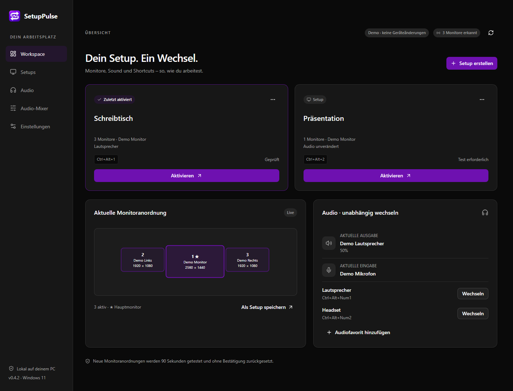

# SetupPulse

**Monitor-Setups und Audiogeräte mit einer Tastenkombination wechseln.**

[English](README.md) · [Änderungen](CHANGELOG.md)

Ein PC am Schreibtisch und am Fernseher: Speichere für jede Situation die passende Monitoranordnung und Audiogeräte. Wechsle anschließend über die App, das Tray oder eine Tastenkombination.

Audiofavoriten funktionieren auch unabhängig. Wechsle zwischen Lautsprechern und Headset, während die Monitore bleiben.

_Beispiel mit simulierten Geräten. Neue Installationen beginnen ohne gespeicherte Setups._

## Funktionen

- **Monitor-Setups:** aktive Monitore, Hauptmonitor, Auflösung, Bildwiederholrate, Ausrichtung, Position und Skalierung festlegen.
- **Audio direkt im Setup:** erkannte Ausgabegeräte und Mikrofone ohne Favoritenpflicht auswählen, optional mit eigenem Anzeigenamen. Favorisieren ist bei Bedarf per Klick möglich.
- **Audiofavoriten:** Wiedergabe-, Mikrofon- und Kommunikationsgeräte wählen, optional mit Lautstärke und Stummschaltung. Unabhängig nutzen oder mit einem Setup verknüpfen.
- **Audio-Mixer:** Lautstärke und Stummschaltung für Geräte und Apps, gruppierte App-Sitzungen, Pegelanzeige und Ausgabezuordnung pro App. Schnellmixer per Tray-Klick; optional Lautstärke per Tray-Mausrad und eigene Mixer-Shortcuts.
- **Globale Shortcuts:** Setups und Audiofavoriten wechseln, ohne die App zu öffnen. Nummernblock und obere Ziffernreihe werden unterschieden.
- **Dunkles Tray-Menü:** aktuell passende Setups, Audiofavoriten und ihre Shortcuts erkennen.
- **Home Assistant:** optionale MQTT-Erkennung, separate Setup-/Audio-Auswahl per Dashboard oder Zigbee-Taster-Automation und Rückmeldung zu Wechseln und Fehlern. [Einrichtung](docs/HOME-ASSISTANT.md).
- **Updates:** direkt im Tool nach stabilen GitHub Releases suchen und sie mit Paketprüfung und erhaltenen Einstellungen installieren. [Update-Anleitung](docs/UPDATES.md).
- **Alltag:** optionaler Windows-Autostart, Hell-/Dunkel-/Systemmodus sowie Profilimport und -export.
- **Bestätigung und Rücksetzung:** neue oder geänderte Monitoranordnungen innerhalb von 90 Sekunden bestätigen. Ohne Bestätigung versucht SetupPulse, den vorherigen Zustand wiederherzustellen.

## Loslegen

Benötigt werden **Windows 11 x64** und die [Microsoft Edge WebView2 Runtime](https://developer.microsoft.com/en-us/microsoft-edge/webview2/).

**Es gibt noch keine Download-Veröffentlichung.** Downloadpakete werden unter [Releases](https://github.com/Skyline311/SetupPulse/releases) bereitgestellt. Ein fertiges Paket läuft ohne Entwicklungswerkzeuge.

Mit einem fertigen Paket:

1. ZIP entpacken und **SetupPulse.exe** starten.
2. **Setup erstellen** wählen, Monitore einstellen und bei Bedarf Ausgabegerät und Mikrofon direkt auswählen.
3. Einen Shortcut vergeben. Unter **Audio** lässt sich ein Gerät über **Favorisieren** zusätzlich mit eigenem Namen und Shortcut speichern.
4. **Setup speichern** anklicken, das Setup aktivieren und das Bild innerhalb von 90 Sekunden mit **Enter** bestätigen.

Bereits bestätigte Monitoranordnungen wechseln später direkt. Beispielsweise verwendet `Strg+Alt+Num2` den Nummernblock, `Strg+Alt+2` die obere Ziffernreihe.

Für unterschiedlich hohe Bildschirme bearbeitest du unter **Setups** die X-/Y-Positionen. Negatives Y verschiebt einen Monitor nach oben, positives Y nach unten. Speichere und aktiviere das Setup, um die Anordnung anzuwenden. Der Live-Höhenabgleich ist vorübergehend nicht verfügbar.

Das Schließen des Fensters lässt die App normalerweise im Tray laufen. Ein einzelner Linksklick öffnet nach der kurzen Doppelklick-Frist ein kleines Schnellmixer-Fenster am Tray; ein Doppelklick öffnet das Hauptfenster. Escape oder ein Klick außerhalb schließt den Schnellmixer; **Voller Mixer** öffnet **Audio-Mixer**. Vollständig beenden über **Tray → Beenden**. Autostart öffnet die App ohne Setup-Wechsel; auch beim Aufwachen wird kein Setup automatisch angewendet.

Unter **Audio-Mixer** regelst du Geräte und laufende Apps oder wählst deren Ausgabe. **Windows-Standard** entfernt die feste App-Zuordnung. Manche Apps übernehmen einen neuen Ausgang erst beim nächsten Start ihrer Audiowiedergabe. Die Mixer-Abfragen pausieren außerhalb einer Mixeransicht und bei verborgenem Fenster. Tray-Mausrad und zusätzliche Shortcuts sind unter **Einstellungen** optional aktivierbar.

## Stand und Hilfe

**Frühe Vorschau · 0.4.4.** Builds sind nicht signiert und benötigen breitere Hardwaretests. Wiederherstellung hängt von Windows, Treibern und angeschlossenen Geräten ab. Die Oberfläche ist derzeit deutschsprachig. Unter Einstellungen werden physische Bluetooth-Adapter und ihr Windows-Status angezeigt; Adapter-Umschaltung ist nicht enthalten.

Hinweise zu Gerätekompatibilität, Einstellungen und Wiederherstellung stehen unter [Fehlersuche](docs/TROUBLESHOOTING.md) auf Englisch. Für Fehlerberichte die Issue-Vorlagen verwenden; Sicherheitsmeldungen sind in [SECURITY.md](SECURITY.md) beschrieben.

## Entwicklung und Lizenz

Anleitungen zum Bauen, Testen und Mitwirken stehen in [CONTRIBUTING.md](CONTRIBUTING.md).

Autor und Ersteller: [Skyline311](https://github.com/Skyline311). Eigener Projektcode steht unter [MIT](LICENSE); Abhängigkeiten behalten ihre Lizenzen, siehe [THIRD-PARTY-NOTICES.md](THIRD-PARTY-NOTICES.md).
