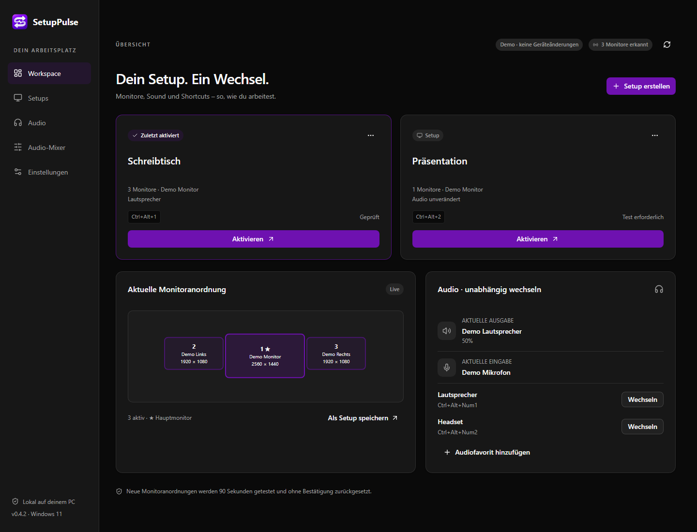

# SetupPulse

**Switch your monitor setup and audio devices with a shortcut.**

[Deutsch](README.de.md) · [Changelog](CHANGELOG.md)

Use one PC at your desk or on your TV: save the right monitor layout and audio devices for each situation, then switch from the app, the system tray, or a keyboard shortcut.

Audio favorites also work independently. Switch between speakers and a headset while keeping your monitors as they are.

_Example with simulated devices. New installations start without saved setups._

## Features

- **Monitor setups:** choose active displays, the main monitor, resolution, refresh rate, rotation, position, and scaling.
- **Direct setup audio:** select any detected output device and microphone directly in a setup, with an optional display name. Save a favorite only when you want one.
- **Audio favorites:** choose playback, microphone, and communication devices, with optional volume and mute settings. Use them independently or link them to a setup.
- **Audio mixer:** device and app volume/mute, grouped app sessions, level meters, and per-app output routing. Click the tray icon for a quick mixer; optionally enable tray-wheel volume and custom mixer shortcuts.
- **Global shortcuts:** switch setups and audio favorites without opening the app. Number-pad keys are supported separately from the number row.
- **Dark tray menu:** see the current matching setups, audio favorites, and their saved shortcuts.
- **Home Assistant:** optional MQTT discovery, independent setup/audio selection from dashboards or Zigbee-button automations, and switch/error feedback. [Setup guide](docs/HOME-ASSISTANT.md).
- **Updates:** check for public stable GitHub Releases and install them from the app, with package verification and preserved settings. [Update guide](docs/UPDATES.md).
- **Everyday use:** optional start with Windows, light/dark/system themes, and profile import/export.
- **Confirmation and recovery:** new or changed monitor layouts must be confirmed within 90 seconds; otherwise SetupPulse attempts to restore the previous arrangement.

## Getting started

Requires **Windows 11 x64** and [Microsoft Edge WebView2 Runtime](https://developer.microsoft.com/en-us/microsoft-edge/webview2/).

Download [**SetupPulse.exe**](https://github.com/Skyline311/SetupPulse/releases/latest/download/SetupPulse.exe) and run it directly. See [Releases](https://github.com/Skyline311/SetupPulse/releases/latest) for version notes and checksums. No source-code download, build tools or .NET SDK are required.

First run:

1. Save **SetupPulse.exe** in a permanent folder and start it.
2. Choose **Setup erstellen**, adjust the monitors, and optionally select an output device and microphone directly.
3. Assign a shortcut. Under **Audio**, use **Favorisieren** to optionally save a device with its own name and shortcut.
4. Click **Setup speichern**, activate the setup, and confirm the picture with **Enter** within 90 seconds.

Confirmed monitor layouts switch directly on later uses. For example, `Ctrl+Alt+Num2` uses the number pad; `Ctrl+Alt+2` uses the number row.

If a setup's audio device remains unavailable, the monitor switch continues with a warning and keeps its saved audio assignment for later use. Confirmation controls appear once the switch is ready.

For displays at different heights, edit a setup under **Setups** and adjust its X/Y positions. Negative Y moves a display up; positive Y moves it down. Save and activate the setup to apply the layout. Live height adjustment is temporarily unavailable.

Closing the window normally leaves the app in the tray, represented by white exchange arrows on a transparent background. A single left click opens a compact quick-mixer window at the tray after the short double-click interval; a double-click opens the main window. Escape or clicking elsewhere closes the quick mixer; **Voller Mixer** opens **Audio-Mixer**. Use **Tray → Beenden** to exit completely. Under **Einstellungen → Bearbeiten**, enable **Mit Windows starten** and choose **Beim Windows-Start minimiert starten** to keep the main window hidden at sign-in. Manual launches open the main window. Starting the app or waking Windows does not apply a setup automatically.

Under **Audio-Mixer**, adjust devices and running apps or choose an app's output. **Windows-Standard** removes its fixed output assignment. Some apps adopt a new output only when their audio playback restarts. Mixer polling pauses outside a mixer view and while the window is hidden. Tray-wheel control and additional shortcuts are optional under **Einstellungen**.

## Status and help

**Early preview · 0.4.7.** Builds are unsigned and need broader hardware testing. Recovery depends on Windows, drivers, and connected devices. The current interface is in German. Settings show physical Bluetooth adapters and their Windows status; adapter switching is not included.

For device compatibility, settings, and recovery, see [Troubleshooting](docs/TROUBLESHOOTING.md). Report problems using the repository's issue templates; security reports are covered by [SECURITY.md](SECURITY.md).

## Development and license

For building, testing, and contributing, see [CONTRIBUTING.md](CONTRIBUTING.md).

Author and creator: [Skyline311](https://github.com/Skyline311). Project code uses the [MIT License](LICENSE); dependencies retain their own licenses, listed in [THIRD-PARTY-NOTICES.md](THIRD-PARTY-NOTICES.md).
